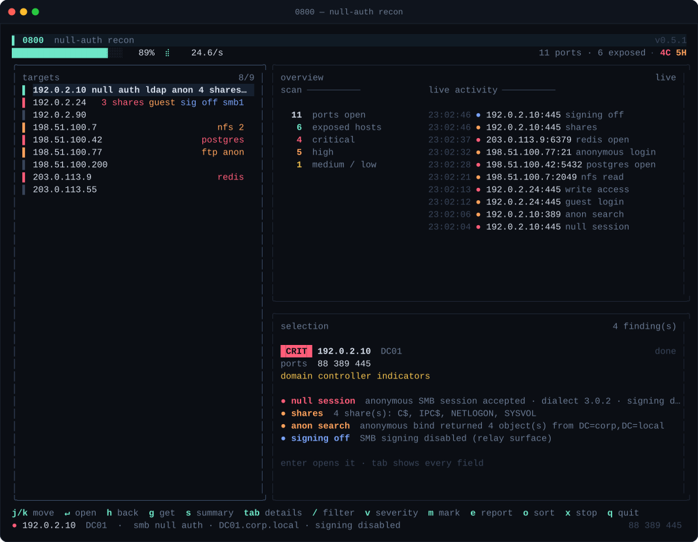
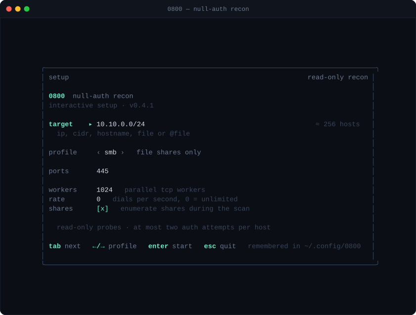
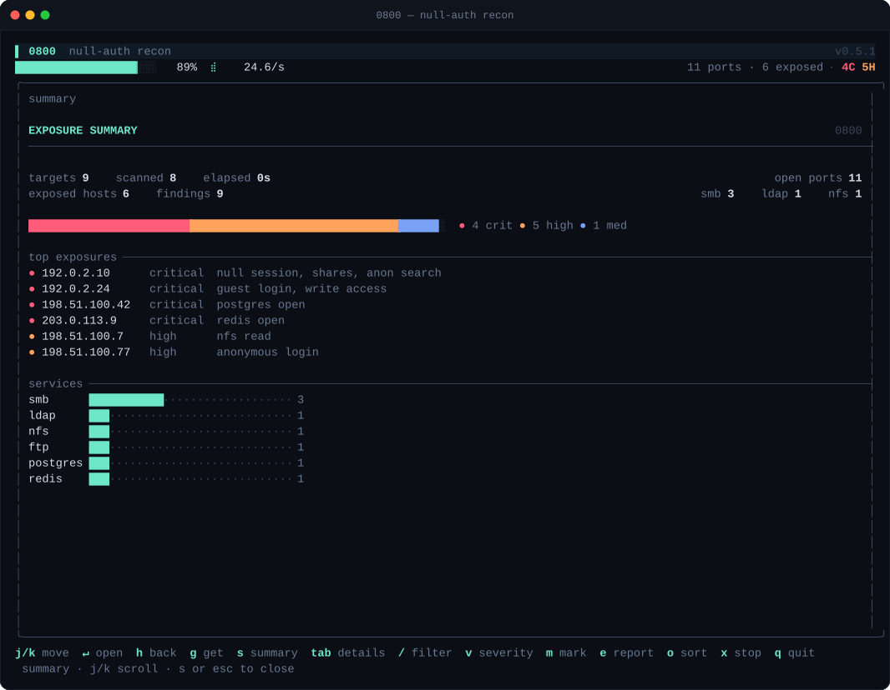
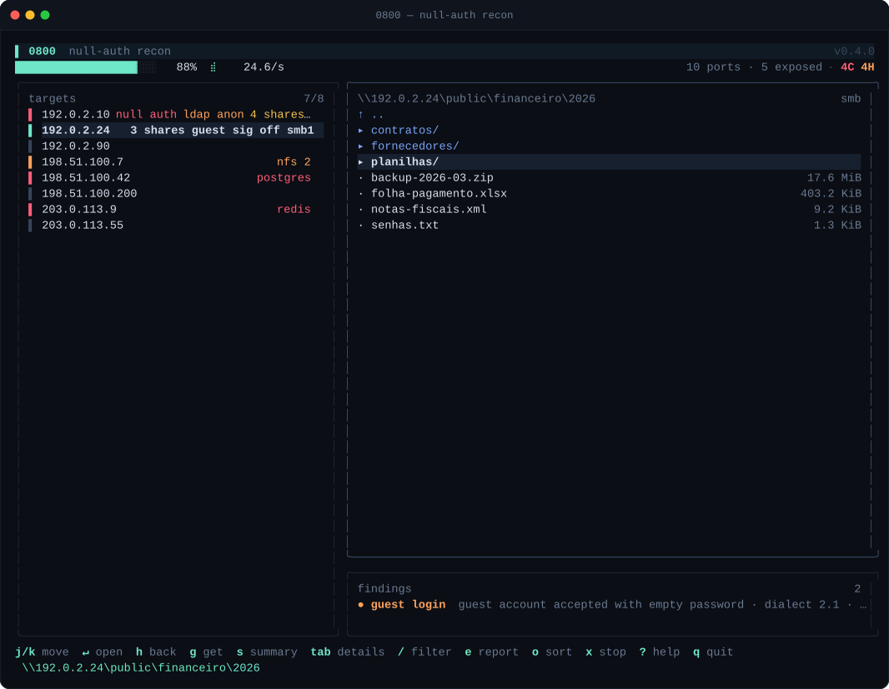
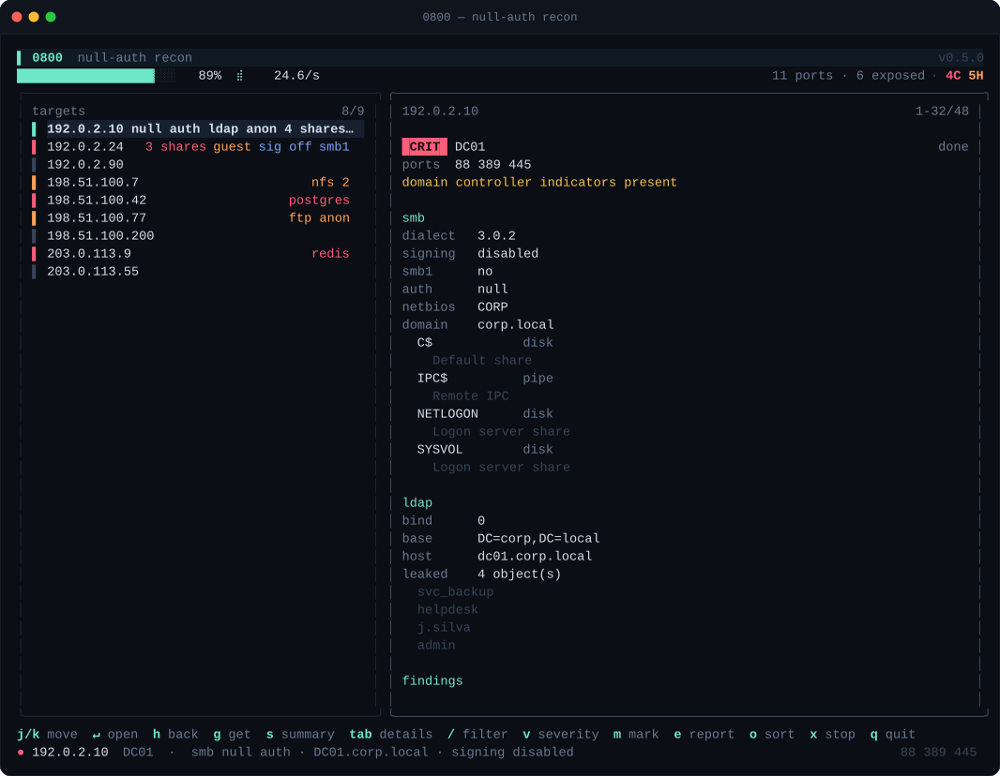
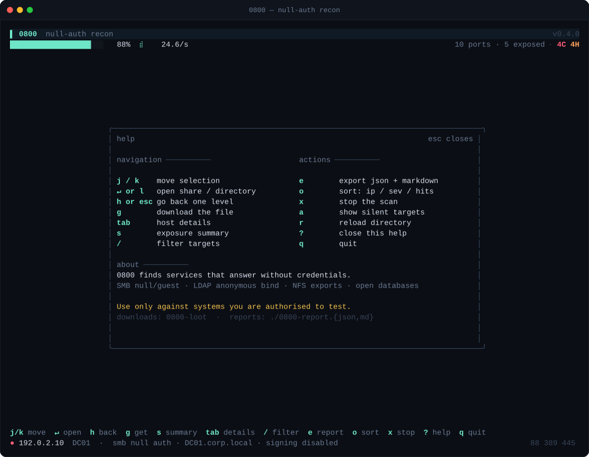

# 0800

**Fast, read-only recon for services that answer without credentials.**

`0800` (Portuguese slang for "free / no charge") finds and browses SMB, LDAP, NFS and database
endpoints that expose data to unauthenticated users. It ships as a single static binary with a
keyboard-driven terminal UI, a headless mode for pipelines, and JSON output for reporting.

[](https://github.com/RshaCuDeVidro/0800/actions/workflows/ci.yml)
[](https://github.com/RshaCuDeVidro/0800/releases)
[](https://go.dev)
[](LICENSE)



---

## What it finds

| Service | Checks | "0800" verdict |
| --- | --- | --- |
| **SMB (445)** | NEGOTIATE, dialects 2.0.2→3.0.2, SMB1 probe, signing mode, NTLM challenge fingerprint, null session, `guest` + empty password | `STATUS_SUCCESS` on `SESSION_SETUP`, shares enumerated |
| **Kerberos (88)** | reachability + correlation with LDAP/SMB | domain-controller confidence score |
| **LDAP (389)** | anonymous bind, root DSE, bounded search (`sizeLimit=5`) | objects readable without credentials |
| **NFS (2049)** | portmapper, `MOUNT_EXPORT`, `MOUNT` with `AUTH_UNIX` (root → nobody fallback), `READDIR` | export mounted and listed |
| **MySQL (3306)** | handshake, auth plugin, `root`/`mysql`/`admin` with empty password | `OK` packet |
| **PostgreSQL (5432)** | `StartupMessage`, `AuthenticationOk` (trust) | trust authentication |
| **Redis (6379)** | `PING`, `INFO server`, `DBSIZE` | `+PONG` |

Everything is **read-only**: no uploads, no writes, no deletes, no password spraying. At most
**two** authentication attempts are made per host (null, then guest) so account lockout policies
are not tripped.

## Setup

Running `0800` on a terminal opens an interactive setup screen — with or without `-t`, and
prefilled with whatever you passed on the command line. The last target and options are
remembered in `~/.config/0800/config.json`.

`--no-menu` skips it for scripts; `--plain` and pipes skip it too. Everything is also a flag, so
automation never depends on the UI.



## Screenshots

| Exposure summary (`s`) | Remote file browser + findings |
| --- | --- |
|  |  |

| Host details (`tab`) | Help (`?`) |
| --- | --- |
|  |  |

## Install

```bash
# go install (Go 1.24+)
go install github.com/RshaCuDeVidro/0800@latest

# or download the archive for your OS/arch from
# https://github.com/RshaCuDeVidro/0800/releases  (linux|darwin|windows _ amd64|arm64)
tar xzf 0800_linux_amd64.tar.gz
sudo mv 0800 /usr/local/bin/
```

Prebuilt binaries are available for Linux, macOS and Windows on `amd64` and `arm64`.
No runtime dependencies: `CGO_ENABLED=0`, pure Go DNS resolver, no `libsmbclient`/`libnfs`.

## Usage

```bash
# a single host
0800 -t 192.0.2.10

# a subnet (authorised scope only)
0800 -t 10.10.0.0/24

# a file with mixed targets, excluding a range
0800 -t targets.txt --exclude 10.10.0.128/25

# headless, pipe-friendly
0800 -t 10.10.0.0/24 --plain | tee scan.log

# JSON report + custom loot directory (combine with --plain for pipelines)
0800 -t 10.10.0.0/24 --json scan.json --loot ./loot

# only the services you care about
0800 -t hosts.txt -p 445,389
```

```
flags:
  -t, --target         IP, CIDR, hostname, file or @file (repeatable)
      --exclude        CIDR or IP to skip (repeatable)
  -p                   comma separated ports (default 445,88,389,2049,3306,5432,6379)
      --timeout        TCP dial timeout (default 700ms)
      --io-timeout     per protocol timeout (default 6s)
      --profile        port preset: full, quick, ad, smb, db
  -c                   parallel TCP workers (default 1024)
      --probe-workers  parallel protocol workers (default 64)
      --rate           max dials/second (0 = unlimited)
      --enum-shares    probe common share names during the scan (short list)
      --menu           always show the interactive setup screen
      --no-menu        skip the setup screen (scripts)
      --max-hosts      refuse to expand beyond this many targets (default 65536)
      --loot           download directory (default 0800-loot)
      --flat           download straight into the loot root
      --remap          probe a non-standard port, e.g. smb=1445,ldap=1389
      --json           write a JSON report
      --plain          headless output
      --no-color       disable ANSI colours
      --demo           run the TUI with built-in example data
```

### Keys

| Key | Action |
| --- | --- |
| `j` / `k`, arrows | move |
| `enter` or `l` | open host / share / directory |
| `h` or `esc` | go back one level |
| `g` | **get** the selected file |
| `tab` | details pane (findings + evidence) |
| `s` | exposure summary (severity, top hosts, services) |
| `e` | export `0800-report.json` + `0800-report.md` |
| `o` | cycle sort: ip / severity / findings |
| `x` | stop the running scan (results stay on screen) |
| `/` | filter hosts by IP, name or tag |
| `a` | show every target, including silent ones |
| `r` | reload the current directory |
| `?` | help |
| `q` | quit |

The right pane is a live dashboard with a stream of the newest findings, plus a preview of the
host under the cursor. Opening an SMB/NFS host splits it into a file tree and that host's
findings; `s` turns the pane into a report-style summary.

Downloads go to `0800-loot/<ip>/<share>/<path>/<file>` (use `--flat` for the current directory).
Files are written to `.part` and renamed on completion, and existing names get a `(1)` suffix.

## Output

### Plain

```
$ 0800 -t 192.0.2.0/24 -p 445,389 --plain
0800 · null-auth recon 0.1.0
  4 target(s) · ports 445,389 · 512 workers

[+] 192.0.2.10 [88,389,445] [DC] smb=3.0.2 auth=null signing=disabled shares=4 ldap_anon=4 | null session: anonymous SMB session accepted · dialect 3.0.2 · signing disabled
[+] 198.51.100.7 [2049] nfs=2 | nfs read: readable without credentials: /srv/backup (42 entries), /srv/media (9 entries)
[·] 203.0.113.55 [445] smb=3.1.1 signing=required

  4 targets · 4 scanned · 6 open ports · 4 findings · 3 exposed hosts · 3s
```

### JSON

```json
{
  "tool": "0800",
  "version": "0.4.2",
  "started": "2026-10-27T12:00:00Z",
  "stats": { "targets": 4, "scanned": 4, "openPorts": 6, "findings": 4, "exposedHosts": 3 },
  "hosts": [
    {
      "ip": "192.0.2.10",
      "ports": [88, 389, 445],
      "domainController": true,
      "smb": {
        "dialect": "3.0.2",
        "signing": "disabled",
        "auth": "null",
        "shares": [{ "name": "SYSVOL", "type": "disk" }]
      },
      "findings": [
        {
          "port": 445, "proto": "smb", "kind": "smb-null",
          "label": "null session", "severity": "critical",
          "detail": "anonymous SMB session accepted · dialect 3.0.2 · signing disabled",
          "evidence": ["SESSION_SETUP null -> SUCCESS (guest=false null=true)"]
        }
      ]
    }
  ]
}
```

Every finding carries the request/response evidence that produced it. A finding without evidence
is an opinion, so the JSON never contains one.

## How detection works

**SMB** — `0800` speaks SMB2 directly (`internal/smb`): NetBIOS framing, `NEGOTIATE`,
`SESSION_SETUP` with hand-built NTLMSSP (including DES-expanded NTLMv1 for the empty-password
guest case), `TREE_CONNECT`, `CREATE`, `QUERY_DIRECTORY`, `READ`. It reports the negotiated
dialect and `SecurityMode`, probes SMB1 on a separate connection (servers that disabled SMB1 may
reset the socket), and pulls the NetBIOS/DNS identity out of the NTLM Type-2 challenge — no
authentication required. Share enumeration uses `srvsvc!NetrShareEnum` over the `IPC$` pipe with
a small in-tree DCE/RPC + NDR encoder; when RPC is blocked it falls back to probing a curated
share list.

There is no third-party SMB library on purpose: the popular pure-Go client is unmaintained and
carries [GO-2026-5051](https://pkg.go.dev/vuln/GO-2026-5051) (out-of-bounds read on malformed
`ReadDir` replies). Shipping that parser would make the scanner exploitable by the hosts it
scans.

**LDAP** — BER is encoded by hand. The prober binds anonymously, reads the root DSE
(`defaultNamingContext`, `dnsHostName`, functional levels) and then performs exactly one bounded
search (`sizeLimit=5`) to prove whether objects are readable. A successful root DSE read alone is
*not* reported as exposure, because it is public by design.

**NFS** — ONC RPC/XDR is implemented in-tree. `0800` resolves the MOUNT port via rpcbind, lists
exports with `MOUNTPROC_EXPORT`, and proves access by calling `MOUNTPROC_MNT` with `AUTH_UNIX`
(uid 0, retried as 65534 for `root_squash` servers). A returned file handle is the proof; a
successful `READDIR` is the evidence.

**Databases** — the wire handshakes are implemented directly (MySQL `HandshakeResponse41`,
PostgreSQL `StartupMessage`, Redis RESP). Empty-password auth is attempted only for the well-known
administrative users, and only once per user.

**Domain controller confidence** is a score, not a port check: `88` open (+1), `389` open (+1),
an AD-style SMB identity (+2), a root DSE naming context (+2). Three or more points shows `DC?`.

## Architecture

```
target.Parse ──► scan.Engine ──► proto probes ──► scan.Store ──► ui.Model
   IP/CIDR/file     two-stage       smb/ldap/nfs      immutable      bubbletea
                    worker pool     db                snapshots      lipgloss
                                        │
                                        ▼
                                   report (json/plain)
```

- **Two-stage scan**: a TCP sweep with a configurable worker pool, then protocol probes only on
  ports that answered. A 65k-host sweep does not open 65k SMB sessions.
- **Immutable snapshots**: workers publish copy-on-write host views; the UI reads an
  `atomic.Pointer[Snapshot]` at 10 Hz. No locks in the render path, no data races.
- **Protocol independence in the browser**: SMB and NFS both implement `remoteFS`
  (`List`/`Open`/`Close`), so the file tree, breadcrumb and download code is shared.
- **Live view**: counters, severity breakdown, top exposures and a finding feed are derived from
  the same immutable snapshot, so the dashboard updates without extra locks.
- **Fuzz-ready parsers**: every decoder that consumes hostile bytes has a fuzz target
  (`go test -fuzz`).

```
main.go
internal/
  target/     IP, CIDR, file and hostname expansion
  scan/       engine, store, per-port dispatch
  smb/        SMB2/3 client, NTLMSSP, DCE/RPC + NDR (srvsvc)
  ldap/       BER codec, anonymous bind, root DSE
  nfs/        ONC RPC, MOUNT, NFSv3
  db/         MySQL, PostgreSQL, Redis probes
  ui/         bubbletea model, theme, browser, details
  report/     JSON and plain renderers
tools/
  screenshot/ renders the TUI to SVG for the docs
```

## Build

```bash
git clone https://github.com/RshaCuDeVidro/0800 && cd 0800
make build      # static binary, version from git
make test       # go test -race ./...
make lint       # gofmt + go vet
make shots      # regenerate docs/screenshots
```

Manual build:

```bash
CGO_ENABLED=0 go build -trimpath -ldflags "-s -w -X main.version=0.1.0" -o 0800 .
```

## Testing

```bash
go test ./...                 # unit + protocol tests
go test -race ./...           # concurrency
go test -run '^$' -fuzz FuzzParseDirEntries -fuzztime 20s ./internal/smb
```

The SMB client is additionally validated against a real SMB2 server (impacket's
`smbserver`): anonymous/guest authentication, `srvsvc` share enumeration, directory listing and
file download. The captured NDR response is a permanent regression test.

The test suite stands up **in-process fake servers** for SMB2, LDAP, ONC RPC/MOUNT/NFSv3, MySQL,
PostgreSQL and Redis, then drives the real client code against them. That means the parsers,
authentication flows and error paths are exercised without root, Docker or network access.

### Local lab

`tools/lab` starts deliberately vulnerable SMB, NFS, MySQL, PostgreSQL and Redis servers on
`127.0.0.1`, so the whole pipeline can be exercised without touching anything real:

```bash
go run ./tools/lab        # terminal 1
go run . -t 127.0.0.1 -p 3306,5432,6379,2049 --remap smb=1445 --plain
```

Expected result: SMB null session with two shares (one writable), two readable NFS exports and
three passwordless databases.

Optional integration run against a real lab:

```bash
0800_SMB_HOST=192.0.2.10 \
0800_LDAP_HOST=192.0.2.10 \
0800_NFS_HOST=192.0.2.10 \
go test -tags integration ./internal/integration -v
```

## Performance and etiquette

- 1024 TCP workers and 64 protocol workers by default; both are flags.
- Two-stage pipeline: a TCP sweep, then protocol probes only on ports that answered.
- Share enumeration is tiered: the scan asks `srvsvc` and, if that is blocked, only probes the
  14 most common share names (bounded to 3 s). The full list is loaded when you open the host,
  so a scan never pays 45 round trips per host. `--enum-shares=false` skips it entirely.
- A per-host budget (15 s) stops slow servers from pinning a worker.
- The UI reads immutable snapshots and rebuilds the visible list only when it changed; a 65k-host
  store refreshes in ~130 ns when nothing moved (see `BenchmarkRefreshBigList`).
- `--rate` caps dials per second globally; use it on monitored networks.
- A target list larger than `--max-hosts` is refused, and CIDRs larger than a `/8` are rejected
  before expansion.
- Failed probes are contained: every protocol call has a deadline, every worker recovers from
  panics, and a malformed reply from a hostile server cannot take down the scan.

## Limitations

- **SMB1 authentication**: SMB1 is detected but sessions are SMB2+. Legacy hosts that only speak
  NT1 are reported (dialect/signing) but not browsed.
- **SMB signing**: when a server *requires* signing, `0800` reports the requirement and the
  credential result but does not sign requests, so browsing is disabled. Implementing SMB2
  signing/encryption would require session-key derivation and is intentionally out of scope.
- **Dialects**: the client offers up to SMB 3.0.2. SMB 3.1.1 pre-authentication integrity is not
  implemented; the server negotiates down.
- **NFSv4**: export discovery and reading are NFSv3 (plus a v4 reachability check). NFSv4
  pseudo-filesystems are not traversed.
- **`srvsvc` enumeration** is best-effort. Some hardened servers deny `NetrShareEnum`; the
  fallback only finds shares whose names are in its list, and costs one round trip per candidate.
- **NFS directories** larger than a single 64 KiB `READDIRPLUS` reply are truncated at the page
  boundary.
- **Kerberos** is fingerprinted by port correlation, not by sending AS-REQs — deliberately, to
  avoid generating authentication events for arbitrary principals.
- Not a vulnerability scanner: `0800` only answers "is this readable without credentials?".

## Legal

`0800` is built for authorised security testing: your own infrastructure, a lab, a client
engagement with written permission, or a bug-bounty scope that explicitly allows it. Running it
against systems you do not own or have permission to test is illegal in most jurisdictions.

The tool is read-only by design, but reading is still access. You are responsible for what you
point it at.

## License

MIT — see [LICENSE](LICENSE).
